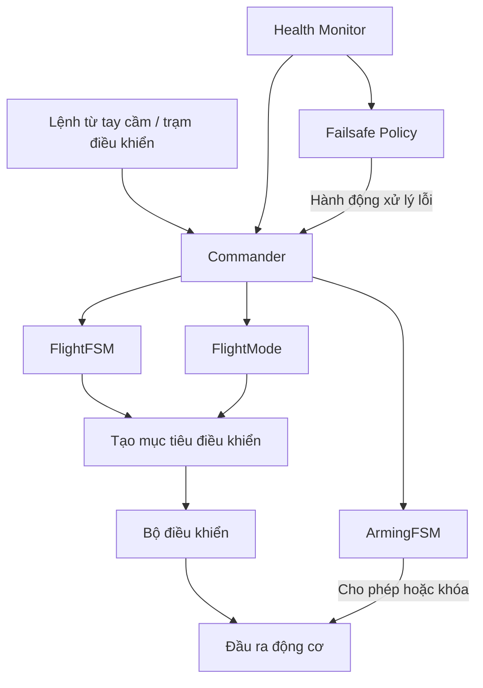
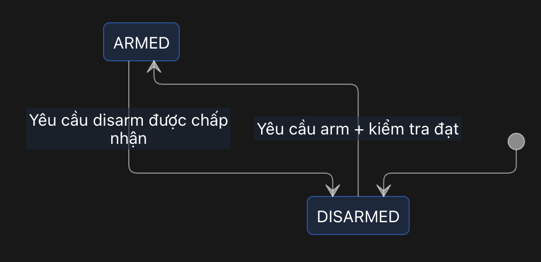
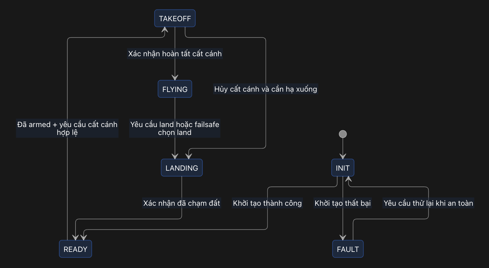

# Firmware_UAV_ESP32

## 1. Tổng quan

Hệ thống gồm hai FSM phối hợp, một bộ quản lý mode bay và một bộ xử lý failsafe:

- **ArmingFSM:** quản lý quyền kích hoạt động cơ.
- **FlightFSM:** quản lý giai đoạn chuyến bay.
- **FlightMode:** xác định cách tạo mục tiêu điều khiển.
- **FailsafePolicy:** chọn hành động khi phát hiện lỗi.

Module `Commander` sở hữu và cập nhật các trạng thái. Các module khác gửi sự kiện hoặc yêu cầu, không trực tiếp sửa trạng thái.

Hai FSM hoạt động song song về mặt logic, không bắt buộc chạy trong hai task riêng. Đề xuất ban đầu là cập nhật cả hai trong cùng một task Commander.



## 2. ArmingFSM

ArmingFSM gồm hai trạng thái:

| Trạng thái | Ý nghĩa |
|---|---|
| `DISARMED` | Đầu ra động cơ ở trạng thái an toàn. |
| `ARMED` | Cho phép điều khiển động cơ; chưa đồng nghĩa UAV đã cất cánh. |



### Điều kiện chuyển trạng thái

- Chỉ cho phép arm khi khởi tạo hoàn tất và các kiểm tra cần thiết đạt yêu cầu.
- Arm bị từ chối thì giữ `DISARMED` và trả nguyên nhân.
- Disarm thông thường cần điều kiện an toàn, chẳng hạn đã xác nhận hạ cánh.
- Dừng động cơ khẩn cấp là yêu cầu riêng, có điều kiện và mức ưu tiên riêng.
- Không tự động disarm chỉ vì phát hiện lỗi trong khi bay.

## 3. FlightFSM

FlightFSM quản lý các giai đoạn chuyến bay:

| Trạng thái | Nhiệm vụ |
|---|---|
| `INIT` | Khởi tạo phần cứng, kiểm tra cấu hình và dữ liệu ban đầu; chặn arm. |
| `READY` | Sẵn sàng, chưa bay; có thể đang disarmed hoặc armed. |
| `TAKEOFF` | Quản lý quá trình cất cánh. |
| `FLYING` | Bay theo mode được chọn. |
| `LANDING` | Hạ cánh có điều khiển; vẫn cần động cơ hoạt động. |
| `FAULT` | Lỗi ngăn hệ thống sẵn sàng bay, ví dụ khởi tạo thất bại; chặn arm. |



Sơ đồ mô tả luồng chính. Các nhánh xử lý khẩn cấp cần được định nghĩa riêng theo khả năng của phương tiện.

### Quy tắc

- Chỉ bắt đầu cất cánh khi `ArmingFSM == ARMED`.
- Trong `TAKEOFF`, `FLYING` và `LANDING`, hoạt động bình thường yêu cầu duy trì `ARMED`.
- Sau khi chạm đất, chuyển về `READY`; disarm được xử lý riêng.
- Lỗi trong khi bay được xử lý qua `FailsafePolicy`, không mặc định chuyển sang `FAULT` rồi tắt động cơ.
- Với Manual, yêu cầu cất cánh có thể được suy ra từ thao tác tay ga hợp lệ.

## 4. FlightMode

Trong giai đoạn `FLYING`, hệ thống hỗ trợ bốn mode:

| Mode | Chức năng |
|---|---|
| `MANUAL` | Tay cầm tạo yêu cầu điều khiển; bộ điều khiển vẫn giữ ổn định UAV. |
| `POSITION` | Điều khiển di chuyển bằng tay cầm; thả cần thì giữ vị trí. |
| `MISSION` | Thực hiện nhiệm vụ theo waypoint. |
| `TRACKING` | Bám mục tiêu thông qua bộ ước lượng mục tiêu và lập quỹ đạo. |

Chuyển mode phải qua kiểm tra điều kiện:

- `POSITION`: dữ liệu vị trí và vận tốc cần thiết còn hợp lệ.
- `MISSION`: nhiệm vụ hợp lệ và đủ điều kiện điều hướng.
- `TRACKING`: mục tiêu hợp lệ và đủ dữ liệu để bám mục tiêu.
- `MANUAL`: đủ dữ liệu cho các vòng điều khiển mà mode sử dụng.

Nên tách chức năng tránh vật cản thành thành phần có thể dùng chung cho nhiều mode.

Lưu riêng hai giá trị:

```text
requested_mode: mode người dùng yêu cầu
active_mode:    mode thực tế đang chạy
```

Hai giá trị có thể khác nhau khi failsafe can thiệp.

## 5. Health Monitor và Failsafe Policy

### Health Monitor

Theo dõi tình trạng hệ thống, ví dụ:

- Cảm biến và dữ liệu ước lượng.
- Pin và nguồn điện.
- Kết nối tay cầm, trạm điều khiển.
- Tính hợp lệ và độ mới của dữ liệu mục tiêu.
- Tình trạng bộ điều khiển và đầu ra động cơ.

### Failsafe Policy

Nhận thông tin lỗi và chọn hành động phù hợp:

| Hành động | Ý nghĩa |
|---|---|
| `WARN` | Cảnh báo, tiếp tục hoạt động nếu được phép. |
| `HOLD` | Giữ vị trí khi đủ điều kiện. |
| `CHANGE_MODE` | Chuyển sang mode còn đủ khả năng hoạt động. |
| `LAND` | Yêu cầu chuyển sang `LANDING`. |
| `EMERGENCY_STOP` | Dừng động cơ theo điều kiện khẩn cấp đã định nghĩa. |

Các hành động là những lựa chọn xử lý, không phải chuỗi trạng thái bắt buộc.

Mỗi loại lỗi phải xác định:

- Điều kiện và thời gian xác nhận lỗi.
- Hành động xử lý.
- Mức ưu tiên khi nhiều lỗi cùng xuất hiện.
- Điều kiện xóa lỗi.
- Có tự khôi phục mode cũ hay không.
- Người điều khiển có được tiếp quản hay không.

Ví dụ: khi mất mục tiêu Tracking nhưng ước lượng vị trí vẫn hợp lệ, hệ thống có thể chuyển sang giữ vị trí. Chỉ tự quay lại Tracking nếu chính sách phục hồi cho phép.

## 6. Ví dụ một chuyến bay

| Tình huống | ArmingFSM | FlightFSM | Mode hoặc hành động |
|---|---|---|---|
| Bật nguồn | `DISARMED` | `INIT` | Khởi tạo |
| Khởi tạo thành công | `DISARMED` | `READY` | Chờ lệnh |
| Arm được chấp nhận | `ARMED` | `READY` | Chờ cất cánh |
| Bắt đầu cất cánh | `ARMED` | `TAKEOFF` | Điều khiển cất cánh |
| Bay bám mục tiêu | `ARMED` | `FLYING` | `TRACKING` |
| Mất mục tiêu, vị trí còn tốt | `ARMED` | `FLYING` | Giữ vị trí theo failsafe |
| Có lệnh hạ cánh | `ARMED` | `LANDING` | Điều khiển hạ cánh |
| Xác nhận đã chạm đất | `ARMED` | `READY` | Chờ disarm |
| Disarm được chấp nhận | `DISARMED` | `READY` | Đầu ra động cơ an toàn |

## 7. Nguyên tắc triển khai

- Commander là nơi duy nhất quyết định chuyển trạng thái.
- Các module gửi sự kiện hoặc yêu cầu qua cơ chế giao tiếp nội bộ.
- Mỗi transition phải định nghĩa: trạng thái hiện tại, sự kiện, điều kiện, trạng thái tiếp theo và hành động.
- Commander phân xử yêu cầu người dùng và failsafe trước khi công bố trạng thái.
- Các bộ điều khiển nhận một bản trạng thái nhất quán.
- Ghi log mọi lần chuyển trạng thái cùng nguyên nhân.
- Kiểm thử các trường hợp: arm bị từ chối, cất cánh, hạ cánh, mất RC, mất vị trí, mất mục tiêu và nhiều lỗi đồng thời.

## 8. Cấu trúc thư mục

```text
Firmware_UAV_ESP32/
├── src/
│   ├── app/
│   │   └── main.c
│   ├── drivers/
│   ├── platform/
│   └── modules/
│       ├── sensors/
│       ├── estimator/
│       ├── commander/
│       ├── health_monitor/
│       ├── failsafe/
│       ├── flight_modes/
│       ├── control/
│       ├── control_allocator/
│       ├── actuator_output/
│       ├── communication/
│       └── logger/
├── lib/
├── boards/
├── msg/
├── config/
└── tests/
```

Đây là cấu trúc tổ chức logic đề xuất. Các file build và vị trí entry point cần được cấu hình phù hợp với framework sử dụng.

### 8.1. `src/app/` — Khởi động ứng dụng

Chứa điểm vào ứng dụng và trình tự khởi động hệ thống.

Nhiệm vụ:

- Nạp cấu hình board và tham số.
- Khởi tạo hạ tầng giao tiếp nội bộ.
- Khởi tạo các module và task.
- Đưa hệ thống vào trạng thái `INIT`.

Không đặt thuật toán điều khiển hoặc toàn bộ logic FSM trong `main.c`.

### 8.2. `src/drivers/` — Giao tiếp thiết bị

Chứa driver cho IMU, barometer, GNSS, cảm biến khoảng cách và các thiết bị ngoại vi.

Nhiệm vụ:

- Cấu hình thanh ghi thiết bị.
- Đọc và ghi dữ liệu qua bus.
- Kiểm tra lỗi giao tiếp.
- Trả dữ liệu và trạng thái thiết bị cho tầng trên.

Quy ước:

- File `.h`: khai báo API, kiểu dữ liệu và cấu hình.
- File `.c`: triển khai giao tiếp và logic riêng của thiết bị.
- Driver không quyết định flight mode, arm/disarm hoặc hành động failsafe.

### 8.3. `src/platform/` — Hạ tầng nền tảng

Cung cấp lớp giao tiếp với hệ điều hành và phần cứng nền tảng:

- Thời gian và timer.
- Task, queue, mutex và cơ chế đồng bộ.
- Truy cập bus I2C, SPI, UART.
- Các tiện ích nền tảng cần dùng chung.

Phân biệt:

- `platform/`: cách thực hiện một giao dịch SPI.
- `drivers/`: cần gửi lệnh SPI nào để đọc một cảm biến cụ thể.
- `boards/`: cảm biến đó nối vào bus và chân nào.

### 8.4. `src/modules/` — Các chức năng hệ thống

| Module | Trách nhiệm |
|---|---|
| `sensors/` | Nhận dữ liệu từ driver, gắn timestamp, hiệu chỉnh và chuẩn hóa dữ liệu cảm biến. |
| `estimator/` | Ước lượng tư thế, vận tốc, vị trí và chất lượng ước lượng. |
| `commander/` | Quản lý FlightFSM, ArmingFSM, mode bay và phân xử các yêu cầu. |
| `health_monitor/` | Theo dõi sức khỏe hệ thống, phát hiện dữ liệu lỗi hoặc quá hạn. |
| `failsafe/` | Chọn hành động xử lý lỗi theo chính sách và mức ưu tiên. |
| `flight_modes/` | Tạo mục tiêu điều khiển cho Manual, Position, Mission và Tracking. |
| `control/` | Thực hiện các vòng điều khiển vị trí, vận tốc, tư thế và tốc độ góc. |
| `control_allocator/` | Phân bổ yêu cầu lực đẩy và mô-men thành yêu cầu cho từng cơ cấu chấp hành. |
| `actuator_output/` | Áp dụng giới hạn, điều kiện cho phép đầu ra và gửi lệnh tới driver đầu ra. |
| `communication/` | Nhận lệnh, truyền telemetry, đóng gói và giải mã protocol bên ngoài. |
| `logger/` | Ghi dữ liệu, sự kiện, lỗi và lịch sử chuyển trạng thái. |

Một thư mục module không bắt buộc tương ứng với một task. Việc chia task dựa trên tần số chạy, độ ưu tiên và yêu cầu thời gian thực.

#### Tổ chức Commander

```text
commander/
├── commander.h
├── commander.c
├── arming_fsm.h
├── arming_fsm.c
├── flight_fsm.h
├── flight_fsm.c
├── mode_manager.h
└── mode_manager.c
```

- `commander`: nhận sự kiện, phân xử yêu cầu và công bố trạng thái.
- `arming_fsm`: xử lý trạng thái arm/disarm.
- `flight_fsm`: xử lý các giai đoạn chuyến bay.
- `mode_manager`: kiểm tra và lựa chọn mode bay.

Commander là nơi duy nhất quyết định cập nhật các trạng thái này.

#### Tổ chức chế độ bay

```text
flight_modes/
├── flight_mode.h
├── manual/
├── position/
├── mission/
└── tracking/
```

Các mode sử dụng giao diện chung để:

- Kiểm tra điều kiện kích hoạt.
- Khởi tạo khi vào mode.
- Cập nhật mục tiêu điều khiển.
- Dọn trạng thái khi rời mode.
- Báo lỗi hoặc hoàn tất nhiệm vụ.

Các mode tạo setpoint, không trực tiếp xuất lệnh tới motor.

### 8.5. `lib/` — Thuật toán và tiện ích dùng chung

Chứa các thành phần có thể tái sử dụng:

- Vector, ma trận và quaternion.
- PID và các thuật toán điều khiển.
- Bộ lọc và phép nội suy.
- Thuật toán hình học.
- Tiện ích xử lý dữ liệu.

Phân biệt:

- `lib/`: triển khai thuật toán PID.
- `modules/control/`: nhận dữ liệu, gọi PID theo chu kỳ và công bố kết quả.

Ưu tiên thiết kế thư viện ít phụ thuộc phần cứng và có thể kiểm thử độc lập.

### 8.6. `boards/` — Cấu hình phần cứng

Chứa cấu hình riêng cho từng board:

- Ánh xạ GPIO.
- Bus và địa chỉ thiết bị.
- Chân chip-select, interrupt.
- Kênh đầu ra motor/servo.
- Hướng lắp cảm biến so với thân phương tiện.

Không đặt thuật toán điều khiển hoặc chính sách failsafe trong cấu hình board.

### 8.7. `msg/` — Định nghĩa dữ liệu nội bộ

Chứa kiểu dữ liệu và quy ước trao đổi giữa các module, ví dụ:

```text
sensor_imu
vehicle_attitude
vehicle_local_position
vehicle_status
health_status
flight_command
trajectory_setpoint
attitude_setpoint
rates_setpoint
actuator_command
```

Các message cần có thông tin phù hợp để kiểm tra:

- Thời điểm lấy mẫu hoặc cập nhật.
- Tính hợp lệ của dữ liệu.
- Đơn vị đo và hệ tọa độ.
- Nguồn dữ liệu nếu có nhiều nguồn.

`msg/` định nghĩa nội dung dữ liệu. Cơ chế truyền nội bộ như queue hoặc publish/subscribe được triển khai riêng.

Protocol truyền ra ngoài được đóng gói và giải mã trong `modules/communication/`.

### 8.8. `config/` — Tham số và cấu hình phương tiện

Chứa:

- Tham số điều khiển.
- Giới hạn vận tốc, góc nghiêng và lực đẩy.
- Ngưỡng phát hiện lỗi.
- Chính sách failsafe.
- Cấu hình hình học và thứ tự motor.
- Giá trị mặc định theo loại phương tiện.

Phân biệt:

- `boards/`: đặc điểm phần cứng điện tử.
- `config/`: đặc điểm phương tiện và hành vi vận hành.

Cấu hình cần được kiểm tra tính hợp lệ trước khi sử dụng.

### 8.9. `tests/` — Kiểm thử

Bao gồm kiểm thử thuật toán, FSM và tích hợp giữa các module.

Các tình huống ưu tiên:

- Khởi tạo thành công hoặc thất bại.
- Arm được chấp nhận hoặc bị từ chối.
- Chuyển mode khi đủ hoặc thiếu điều kiện.
- Cất cánh và hạ cánh.
- Mất RC, mất vị trí hoặc mất mục tiêu Tracking.
- Dữ liệu cảm biến quá hạn.
- Nhiều lỗi xuất hiện đồng thời.
- Phục hồi sau lỗi.
- Yêu cầu disarm không hợp lệ khi đang bay.

## 9. Nguyên tắc phân chia trách nhiệm

Luồng dữ liệu điều khiển điển hình:

```text
Drivers
   ↓
Sensors
   ↓
Estimator
   ↓
Flight Modes → Control → Control Allocator → Actuator Output
```

Estimator cũng cấp dữ liệu trực tiếp cho các vòng điều khiển cần sử dụng.

Luồng quản lý trạng thái:

```text
Lệnh người dùng ──────────────────┐
                                 ↓
Health Monitor → Failsafe Policy → Commander
                                 ↓
                    Trạng thái và mode được công bố
```

Các nguyên tắc chung:

- Driver chỉ xử lý giao tiếp thiết bị.
- Estimator cung cấp trạng thái ước lượng và chất lượng dữ liệu.
- Flight mode tạo mục tiêu điều khiển.
- Controller tính toán yêu cầu lực đẩy và mô-men.
- Commander quyết định trạng thái và mode.
- Failsafe Policy đề xuất hành động; Commander áp dụng.
- Actuator Output thực thi điều kiện cho phép đầu ra.
- Module giao tiếp không tự sửa FSM hoặc điều khiển trực tiếp motor.
- Mỗi trạng thái dùng chung phải có một nơi sở hữu và cập nhật rõ ràng.