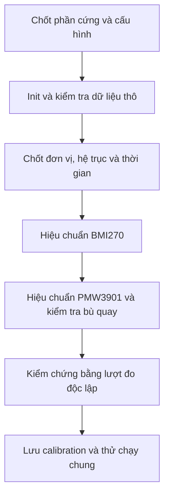

# Quy trình khởi tạo, hiệu chuẩn và kiểm thử PMW3901 + BMI270

Ngày viết: 07/11/2026. Áp dụng cho dự án ESP32 dùng ESP-IDF này.

Tài liệu triển khai bốn nội dung: khởi tạo/giao thức cảm biến; hợp đồng dữ liệu; hiệu chuẩn và xử lý mất mẫu; kiểm thử driver và timing. Đọc [huongdan.md](huongdan.md) để biết thứ tự viết các file/hàm, và [cheat sheet ESP-IDF](ESP_IDF_Drone_Driver_Cheat_Sheet_v2.md) để tra cú pháp API.

Các struct, tên hàm ứng dụng và ngưỡng kiểm tra dưới đây là **đề xuất để triển khai**, chưa phải chức năng đã có trong source. Những bước kiểm tra phần cứng chưa được thực hiện. Không ghi kết quả minh họa thành calibration thật của board.

## 1. Mục tiêu và thứ tự thực hiện

Phân biệt ba việc:

| Việc | Câu hỏi cần trả lời |
| --- | --- |
| Khởi tạo | IC đã được nhận diện, nạp cấu hình và tạo mẫu mới đúng chưa? |
| Hiệu chuẩn | Bias, scale và hướng trục có làm sai số đo không? |
| Kiểm chứng | Với dữ liệu mới và tải thực tế, kết quả còn đạt yêu cầu không? |

Không dùng hiệu chuẩn để che lỗi SPI, sai byte, sai range hoặc mất mẫu.



Trong repo hiện tại, PMW3901 chưa có hàm đọc/init IC hoàn chỉnh; BMI270 `.c` còn trống. Vì vậy cần hoàn thành bước B trong sơ đồ trước khi thu số liệu hiệu chuẩn. PMW cũng cần thống nhất CS thủ công hoặc tự động: source hiện đang dùng cả hai cơ chế.

## 2. Chuẩn bị một phiên đo có thể lặp lại

Chuẩn bị board cố định chắc, dây nối ngắn, nguồn ổn định, thước/đồ gá, mặt phẳng có texture và máy ghi log. Khi thao tác trên khung drone, để disarmed và tháo cánh quạt trong toàn bộ thử nghiệm trên bàn.

Ghi lại trước khi đo:

| Nhóm | Nội dung phải lưu |
| --- | --- |
| Phần cứng | Board/module, vị trí cảm biến, pinout, nguồn, hướng lắp |
| Phần mềm | Commit firmware, ESP-IDF, commit Bosch SensorAPI/bảng init PMW |
| BMI270 | ODR accel/gyro, range, bandwidth/filter, power mode, DRDY/FIFO |
| PMW3901 | Chu kỳ đọc, SPI clock, phiên bản bảng init, hướng quang học |
| Điều kiện | Nhiệt độ nếu đo được, ánh sáng, texture, độ cao và dụng cụ tham chiếu |
| Ghi dữ liệu | Định dạng log, nguồn timestamp, số lần bỏ mẫu/log, mã phiên đo |

Giữ cấu hình đo giống cấu hình định sử dụng. Nếu đổi range, filter, hướng lắp, cơ khí hoặc thuật toán xử lý, đánh giá lại calibration thay vì mặc định vẫn đúng.

## 3. Khởi tạo và xác nhận giao thức

### 3.1. PMW3901

1. Tầng board tạo SPI bus; driver thêm device. Với cách chia giao dịch hiện có, dùng CS GPIO thủ công và đặt `spics_io_num = -1`.
2. Cấu hình CS output, idle HIGH. Một lệnh phải giữ CS LOW qua địa chỉ, khoảng chờ và dữ liệu; nhả CS/bus ở cả nhánh lỗi.
3. PMW dùng SPI mode 3, bit 7 địa chỉ bằng 1 để ghi và 0 để đọc.
4. Theo một bản tham chiếu nhất quán: reset giao tiếp, ghi `0x5A` vào `0x3A`, chờ, kiểm tra `0x00 → 0x49` và `0x5F → 0xB6`, đọc bỏ motion ban đầu, chạy bảng init.
5. Chỉ đặt trạng thái sẵn sàng khi mọi bước thành công. Lấy đầy đủ bảng và delay từ [driver Bitcraze](https://github.com/bitcraze/Bitcraze_PMW3901/blob/master/src/Bitcraze_PMW3901.cpp), không tự rút gọn.

Sau init, xác nhận delta có cả dấu âm/dương và quality thay đổi theo điều kiện bề mặt. Giao dịch SPI thành công chỉ chứng minh đã truyền xong; nó không bảo đảm dữ liệu quang học sử dụng được. Dùng burst khi hoàn thiện driver để lấy delta và quality trong cùng lần đọc.

### 3.2. BMI270

Hướng triển khai đề xuất là dùng Bosch SensorAPI và tự viết port ESP-IDF:

```text
Tạo device/context → nối callback read/write/delay
→ bmi270_init → cấu hình ODR/range/filter
→ bật accel/gyro → kiểm tra mẫu mới → bật luồng DRDY/FIFO
```

`bmi270_init()` xử lý cấu hình đặc thù và config image; đọc đúng ID chưa đủ chứng minh init xong. Dùng cùng commit cho các file Bosch. Xem [implementation khởi tạo BMI270](https://github.com/boschsensortec/BMI270_SensorAPI/blob/master/bmi270.c).

Với SPI, BMI270 dùng bit đọc/ghi ngược PMW. Trong SensorAPI, callback đọc nhận chiều dài đã tính dummy; trả đủ dữ liệu sau byte địa chỉ để thư viện tự bỏ dummy, tránh bỏ hai lần. Xem [bmi2_get_regs()](https://github.com/boschsensortec/BMI270_SensorAPI/blob/master/bmi2.c).

Đọc lại cấu hình và kiểm tra status data-ready trước khi coi dữ liệu là mẫu mới. Luồng cấu hình/enable/read được minh họa trong [ví dụ accel/gyro Bosch](https://github.com/boschsensortec/BMI270_SensorAPI/blob/master/bmi270_examples/accel_gyro/accel_gyro.c). Không nối phép hiệu chuẩn vào luồng đọc cho đến khi dữ liệu thô và timestamp ổn định.

### 3.3. Những kiểm tra phải qua trước hiệu chuẩn

- ID và cấu hình đọc lại ổn định qua nhiều lần bật nguồn.
- Byte có dấu/endian được giải mã đúng; không có giá trị toàn `0x00`/`0xFF` bị coi là mẫu hợp lệ.
- Không clipping: raw không liên tục chạm giới hạn dương/âm của range.
- Đếm được mẫu mới; không lấy cùng một mẫu nhiều lần để đủ số lượng hiệu chuẩn.
- Lỗi đọc được truyền ra ngoài; output không chứa một phần dữ liệu mới và một phần cũ.

## 4. Hợp đồng dữ liệu: đơn vị, trục và thời gian

### 4.1. Chọn hệ trục trước khi tính bias/scale

Quy ước đề xuất:

- `S`: hệ trục IMU theo datasheet và hướng lắp.
- `B`: hệ thân drone, X hướng trước, Y hướng phải, Z hướng xuống; hệ tay phải.
- `F`: hai trục motion count của PMW; không tự coi là X/Y thân.
- `R_BS`: ma trận chuyển vector từ IMU sang thân, `v_B = R_BS × v_S`.

Lưu sơ đồ hướng lắp và kiểm tra quay thuận từng trục. Với ma trận xoay, kiểm tra `R_BS × transpose(R_BS) ≈ I` và `det(R_BS) ≈ +1`; một phép đảo dấu đơn độc có thể tạo phản xạ thay vì phép quay đúng.

Thứ tự xử lý đề xuất:

```text
raw → scale danh định sang SI → trừ bias/hiệu chỉnh trong hệ S
    → đổi trục S sang B → lọc theo thiết kế → estimator
```

Nếu SensorAPI đã remap trục hoặc bù offset phần cứng, ghi rõ và điều chỉnh pipeline để không áp dụng lại cùng một phép hiệu chỉnh.

### 4.2. Định dạng mẫu đề xuất

```c
#include <stdint.h>

enum {
    SAMPLE_DATA_OK       = 1u << 0,
    SAMPLE_TIME_OK       = 1u << 1,
    SAMPLE_CAL_OK        = 1u << 2,
    SAMPLE_QUALITY_OK    = 1u << 3,
    SAMPLE_GAP_BEFORE    = 1u << 4,
    SAMPLE_SATURATED     = 1u << 5
};

typedef struct {
    uint32_t sequence;          /* Tăng trước khi publish/enqueue mỗi mẫu mới. */
    uint32_t reset_epoch;       /* Tăng sau mỗi lần tái khởi tạo trong phiên boot. */
    int64_t accel_time_us;
    int64_t gyro_time_us;
    int64_t read_done_us;
    int16_t accel_raw[3];       /* Hệ S; count. */
    int16_t gyro_raw[3];        /* Hệ S; count. */
    float accel_body_mps2[3];   /* Hệ B; specific force, chưa loại trọng lực. */
    float gyro_body_rad_s[3];   /* Hệ B. */
    uint32_t accel_flags;
    uint32_t gyro_flags;
} imu_sample_t;

typedef struct {
    uint32_t sequence;
    uint32_t reset_epoch;
    int64_t integration_start_us;
    int64_t integration_end_us;
    int64_t read_done_us;
    int16_t dx_counts;          /* Hệ F, giữ raw để chẩn đoán. */
    int16_t dy_counts;
    uint16_t shutter;
    uint8_t squal;
    uint8_t motion;
    uint8_t observation;
    uint32_t flags;
} flow_sample_t;
```

Đây là contract mở rộng để lựa chọn khi triển khai, thay cho các struct tối giản trong `huongdan.md`; không khai báo hai bản khác nhau cùng tên trong firmware. Đặt phiên bản chính thức ở một header dùng chung.

Giữ timestamp accel và gyro riêng nếu ODR/pha lấy mẫu khác nhau. Đọc cùng một transaction không chứng minh hai kênh có cùng thời điểm lấy mẫu. `sequence` giúp phát hiện mất gói sau producer; nó không tự đếm được mẫu đã bị IC ghi đè trước khi đọc.

### 4.3. Ý nghĩa timestamp và validity

| Trường hợp | Quy tắc |
| --- | --- |
| Đọc thanh ghi bằng polling | `read_done_us` là thời gian nhận xong; thời điểm lấy mẫu chỉ là ước lượng nếu chưa có DRDY/sensor time |
| Có DRDY | Ghép sự kiện đúng với mẫu; tính cả độ trễ nội bộ/filter, không đồng nhất IRQ với thời điểm vật lý tuyệt đối |
| Đọc FIFO | Mỗi mẫu có thời gian riêng, suy ra từ sensor time/ODR và mốc đồng bộ; không đóng dấu cả lô bằng một thời gian |
| Flow tích lũy | Cần hai đầu khoảng tích phân xác định; sau init/reset/lỗi có thể phải bỏ khoảng đầu |
| Timestamp chưa xác định | Xóa `SAMPLE_TIME_OK`; không tự tạo `dt` bằng chu kỳ mong muốn |

Với flow, `integration_end_us - integration_start_us > 0` chỉ có ý nghĩa khi mapping với khoảng tích lũy đã được xác nhận. Một timestamp 64-bit dùng chung giữa ISR và task trên ESP32 cần đồng bộ đúng; `volatile` không đủ.

`esp_timer_get_time()` cung cấp thời gian microsecond đơn điệu, không phải giờ lịch. Độ phân giải đó không bảo đảm callback hoặc task chạy đúng từng microsecond. Xem [ESP Timer](https://docs.espressif.com/projects/esp-idf/en/v6.1/esp32/api-reference/system/esp_timer.html).

Ứng dụng xét riêng: truyền đúng, thời gian đúng, calibration hợp lệ, chất lượng đạt và tuổi mẫu dưới ngưỡng. Mẫu flow có thể còn giá trị raw dù thiếu độ cao để đổi sang m/s.

## 5. Hiệu chuẩn BMI270

### 5.1. Chốt scale danh định

Với raw signed 16-bit:

```text
a_nominal_S = accel_raw × accel_range_g × 9.80665 / 32768
w_nominal_S = gyro_raw × gyro_range_dps × (pi / 180) / 32768
```

Range lấy từ cấu hình đã xác nhận; đây chưa phải bù sai số của từng board. Tham khảo phép đổi đơn vị trong [ví dụ Bosch](https://github.com/boschsensortec/BMI270_SensorAPI/blob/master/bmi270_examples/accel_gyro/accel_gyro.c).

### 5.2. Thu dữ liệu đứng yên để tính gyro bias

Quy trình thử nghiệm đề xuất:

1. Cố định board, giữ dây không kéo lệch, bật nguồn và theo dõi nhiệt độ/mean gyro đến khi tương đối ổn định. Một phút chỉ là mốc khởi đầu để quan sát, không phải bảo đảm đã ổn nhiệt.
2. Thu một cửa sổ mẫu mới; ví dụ 10 giây ở 100 Hz được khoảng 1000 mẫu. Chỉ dùng mẫu không lỗi, không clipping và không có khoảng trống chưa giải thích được.
3. Kiểm tra độ ổn định bằng độ lệch chuẩn gyro, độ lệch chuẩn accel và biến thiên chuẩn accel. Kết hợp quan sát đồ gá; quay chậm đều vẫn có thể cho phương sai thấp.
4. Nếu board bị chạm/di chuyển, loại cửa sổ đó rồi thu lại. Không tính trung bình trộn đoạn đứng yên với đoạn đang xoay.
5. Tính bias trên từng trục ở hệ S, dùng dữ liệu SI trước phép bù phần mềm mới.

```text
b_g[i] = mean(w_nominal_S[i])
sigma_g[i] = sqrt(sum((w_nominal_S[i] - b_g[i])²) / (N - 1))
w_corrected_B = R_BS × (w_nominal_S - b_g)
```

Đơn vị `b_g` và `sigma_g` là rad/s. Dùng `N > 1`, phép cộng đủ chính xác hoặc thuật toán phương sai online ổn định; không cộng hàng nghìn raw vào `int16_t`.

**Kiểm chứng:** giữ nguyên bias, thu một lượt đứng yên mới rồi đo mean còn dư và độ trôi góc tích phân. Không đánh giá trên đúng tập vừa dùng để tính mean: kết quả bằng gần 0 trên tập đó là điều hiển nhiên.

Bias tĩnh không hiệu chuẩn được hệ số nhạy gyro. Muốn kiểm tra scale, quay theo góc/tốc độ tham chiếu đã biết, tích phân bằng `dt` thực và so sánh cả hai chiều từng trục. Không tự suy ra scale từ việc “quay khoảng 90 độ” bằng tay.

### 5.3. Hiệu chuẩn accel bằng sáu tư thế

Mô hình đầu tiên chỉ sửa bias và scale từng trục, chưa xử lý đầy đủ sai lệch không vuông góc. Đo mỗi trục ở cả +1 g và −1 g, lấy trung bình, rồi tính offset và gain. Cơ sở phương pháp: [Analog Devices AN-1057, phần Basic Calibration Techniques](https://www.analog.com/en/resources/app-notes/an-1057.html).

Trong hệ S, đặt **chiều dương trục cần đo hướng lên** để specific force tĩnh trên trục đó gần +g; đảo xuống để gần −g. Xác nhận bằng số đo thực trước khi gắn nhãn tư thế.

| Tư thế | Specific force mục tiêu trong hệ S |
| --- | --- |
| +X | `(g, 0, 0)` |
| −X | `(-g, 0, 0)` |
| +Y | `(0, g, 0)` |
| −Y | `(0, -g, 0)` |
| +Z | `(0, 0, g)` |
| −Z | `(0, 0, -g)` |

Dùng đồ gá vuông để giảm sai số góc. Mỗi tư thế: chờ hết dao động và đáp ứng quá độ của filter, thu cửa sổ đứng yên, lưu mean/std cả ba trục. Không đưa mẫu lúc lật board vào cửa sổ.

Gọi `m_plus[i]`, `m_minus[i]` là mean của trục i tại hai tư thế tương ứng, đã đổi sang m/s². Giải mô hình tuyến tính hai điểm:

```text
b_a[i] = (m_plus[i] + m_minus[i]) / 2
s_a[i] = 2 × g / (m_plus[i] - m_minus[i])
a_corrected_S[i] = s_a[i] × (a_nominal_S[i] - b_a[i])
a_corrected_B = R_BS × a_corrected_S
```

`b_a` có đơn vị m/s²; `s_a` không có đơn vị và là hệ số **nhân hiệu chỉnh**, không phải gain đo thô. Nếu mẫu số gần 0, sai dấu hoặc hệ số lệch bất thường, kiểm tra tư thế/range/byte trước khi chấp nhận.

Ví dụ số tự tạo để kiểm tra phép tính: `m_plus=9.95`, `m_minus=-9.65` m/s² cho `b=0.15` m/s², `s≈1.00068`. Sau sửa, hai điểm về khoảng ±9.80665 m/s². Không dùng các số này cho board thật.

**Kiểm chứng độc lập:** đặt lại sáu tư thế và vài tư thế nghiêng chưa dùng khi fit; kiểm tra chuẩn accel gần g và hướng vector đúng. Chỉ đúng chuẩn g chưa chứng minh đúng hướng trục. Nếu sai số thay đổi mạnh theo góc, xem lại đồ gá, hướng lắp hoặc mô hình ma trận đầy đủ. Mô hình nâng cao được trình bày trong [NXP AN4399](https://www.nxp.com/docs/en/application-note/AN4399.pdf).

Không trừ vector trọng lực của một tư thế khỏi mọi mẫu. Accelerometer đo specific force; khi đứng yên vẫn có độ lớn gần g. Loại trọng lực để suy ra gia tốc chuyển động là công việc của estimator với tư thế hiện tại.

### 5.4. Nhiệt độ và thay đổi điều kiện

Sau khi hiệu chuẩn cơ bản, lặp lại đo bias ở các mức nhiệt ổn định trong dải sử dụng. Nếu có dữ liệu nhiệt độ đáng tin cậy, có thể fit `b_g(T) = b0 + k × (T - T0)` hoặc dùng bảng nội suy. Lưu dải nhiệt đã đo; không ngoại suy tùy ý.

Không cập nhật bias runtime khi drone đang chuyển động chỉ vì mean gyro khác 0. Dùng điều kiện đứng yên đã kiểm chứng và giới hạn tốc độ cập nhật. Thay kết cấu gá/lực siết cần đo lại sai số sau lắp ráp.

## 6. Hiệu chuẩn PMW3901

### 6.1. Tách count, chuyển động và độ cao

PMW trả motion count. Đổi count thành khoảng cách cần mô hình và khoảng cách tới bề mặt; bản thân PMW không cung cấp độ cao. Xem [ghi chú của Bitcraze](https://github.com/bitcraze/Bitcraze_PMW3901/blob/master/readme.md).

Quy trình bên dưới là phép đo đề xuất cho board của bạn: bề mặt phẳng đứng yên, quang trục gần vuông góc mặt phẳng, chiều cao h cố định trong mỗi lượt, chỉ tịnh tiến ngang và hạn chế quay. Nó không phải công thức tổng quát cho mọi tư thế bay.

### 6.2. Thu dữ liệu tịnh tiến có quãng đường chuẩn

1. Gá cảm biến nhìn xuống mặt có texture, đo h từ mốc quang học phù hợp đến mặt phẳng. Ghi sai số đo h.
2. Dùng đường trượt/thước để dịch cảm biến theo +X thân một quãng biết trước, sau đó làm riêng −X, +Y, −Y. Bề mặt giữ nguyên.
3. Đánh dấu đầu/cuối lượt khi đang đứng yên; chỉ cộng các khoảng flow nằm trong cửa sổ chuyển động đầy đủ. Không đọc tùy tiện giữa chừng làm mất count tích lũy.
4. Lưu tổng count X/Y, quãng đường có dấu, h, góc quay gyro, quality và cờ mất mẫu. Loại lượt có khoảng mất dữ liệu thay vì bỏ vài mẫu rồi coi tổng còn lại là toàn bộ quãng đường.
5. Lặp lại mỗi chiều ở vài tốc độ, nhiều quãng đường và ít nhất hai độ cao nằm trong vùng hoạt động thực tế đã kiểm tra.

Mẫu bảng log **chưa có số đo**:

| Run | h (m) | dX thân (m) | dY thân (m) | Tổng count X | Tổng count Y | Quay/mất mẫu | Dùng để fit? |
| --- | --- | --- | --- | --- | --- | --- | --- |
| X+_01 | Điền | Điền | 0 | Điền | Điền | Điền | Có/không |
| X-_01 | Điền | Điền | 0 | Điền | Điền | Điền | Có/không |
| Y+_01 | Điền | 0 | Điền | Điền | Điền | Điền | Có/không |
| Y-_01 | Điền | 0 | Điền | Điền | Điền | Điền | Có/không |

### 6.3. Tính scale và hướng trục

Định nghĩa `c = [sum(dx), sum(dy)]ᵀ`, `d = [dX_body, dY_body]ᵀ`. Với điều kiện thí nghiệm ở trên, fit mô hình thực nghiệm:

```text
d / h ≈ K × c
```

`K` là ma trận 2×2 đổi count hệ F sang chuyển vị thân đã chuẩn hóa theo độ cao; nó bao gồm dấu, hoán đổi trục và scale. Không gọi `K` là ma trận xoay thuần, cũng không tự coi output của nó là góc quang học chuẩn cho mọi tư thế.

Fit bình phương tối thiểu bằng QR/SVD từ nhiều lượt độc lập theo hai hướng; không fit ma trận 2×2 chỉ bằng một đường chuyển động. Trường hợp hai trục đã thẳng hàng và đã xác định dấu/hoán vị, có thể fit từng hệ số `k` từ `d/h ≈ k × sum(count)`.

Giữ riêng lượt kiểm chứng, tính:

```text
d_est = h × K × c
error_abs = norm(d_est - d_ref)
error_relative = error_abs / norm(d_ref)   # Chỉ khi quãng đường tham chiếu đủ lớn.
```

Nếu sai số tăng theo h, xem lại mốc đo độ cao. Nếu khác giữa hai chiều, kiểm tra quay ngoài ý muốn, clipping, timing và cộng thiếu khoảng. Nếu thay đổi mạnh theo texture/ánh sáng, cần phân loại chất lượng; không ép một scale duy nhất khớp mọi mẫu xấu.

Khi h thay đổi, không nhân tổng count cả lượt với độ cao cuối lượt. Cần tính theo từng khoảng có h/tư thế tương ứng hoặc dùng mô hình đo của estimator.

### 6.4. Đồng bộ IMU và bù ảnh hưởng quay

Flow do tịnh tiến và do quay phải được phân biệt. Mô hình Bitcraze dùng cả độ cao, tư thế, tốc độ góc và vận tốc tại vị trí cảm biến; đây là tài liệu tham chiếu để xây mô hình, không phải bộ hằng số dùng chung cho mọi board. Xem [mô hình flow Crazyflie](https://github.com/bitcraze/crazyflie-firmware/blob/master/src/modules/src/kalman_core/mm_flow.c).

Quy trình kiểm tra đề xuất:

1. Dùng gyro đã hiệu chuẩn, đổi sang cùng hệ trục với mô hình flow.
2. Với mỗi khoảng flow `[t0, t1]`, tích phân gyro trên đúng khoảng đó, xử lý phần mẫu giao biên. Không lấy một mẫu gyro cuối khoảng nhân với `dt` nếu tốc độ quay thay đổi.
3. Kiểm tra độ trễ tương đối của hai đường đo bằng nhiều lượt quay qua lại có tham chiếu. Delay filter/driver phải được tính trong mapping thời gian.
4. Dùng đồ gá quay gần tâm quang học để kiểm tra phản ứng khi chủ yếu quay. Nếu quay quanh tâm thân cách camera một vector `r_B`, vận tốc camera còn có thành phần `omega_B × r_B`.
5. Sau bù, kiểm tra lại tịnh tiến thuần và chuyển động hỗn hợp. Không sửa dấu ngẫu nhiên để một lượt quay có vẻ đúng.

Không trừ trực tiếp `dx_counts - gyro_rad_s`: hai đại lượng khác đơn vị và khác kiểu tích lũy. Nếu chưa xác định mô hình/trễ, giữ raw flow, gyro và timestamp; đánh dấu giới hạn sử dụng thay vì xuất vận tốc đã bù giả.

### 6.5. Xác định ngưỡng chất lượng từ dữ liệu

Đo các điều kiện: đứng yên, tịnh tiến, ít texture, ánh sáng yếu/mạnh, mặt bóng, thay đổi độ cao và chuyển động nhanh. Log SQUAL, shutter, motion/observation, sai số so với tham chiếu và số mẫu mất.

Chọn ngưỡng sao cho loại được vùng sai số lớn mà vẫn giữ đủ mẫu tốt. SQUAL không tự là xác suất tin cậy; không chép một ngưỡng từ module khác rồi coi đã hiệu chuẩn. Có thể dùng hysteresis và yêu cầu nhiều mẫu tốt liên tiếp để phục hồi trạng thái quality.

`dx=dy=0` có thể là đứng yên; count khác 0 có thể là noise. Không trừ một “bias flow” cố định chỉ từ một mặt sàn nếu chưa chứng minh nó ổn định trên các điều kiện sử dụng.

## 7. DRDY, FIFO, mất mẫu và phục hồi lỗi

### 7.1. Luồng dữ liệu đề xuất

```text
DRDY ISR → ghi sự kiện/timestamp → notify task
task → đọc status/FIFO → decode → gắn thời gian/flags
     → hiệu chỉnh → queue → sensors/estimator
```

ISR không đọc SPI/I2C blocking, không log dài và không chờ mutex. Tạo task/context trước khi enable ngắt; disable ngắt và chờ producer dừng trước khi giải phóng context. Dùng API `FromISR` trong ISR, theo [FreeRTOS ESP-IDF](https://docs.espressif.com/projects/esp-idf/en/v6.1/esp32/api-reference/system/freertos_idf.html).

Notification đếm sự kiện, không lưu mọi mẫu. Với đọc thanh ghi trực tiếp, nhiều DRDY trước một lần đọc có thể đồng nghĩa mất mẫu; với FIFO watermark, một ngắt có thể đại diện nhiều mẫu. Không mặc định số notification bằng số mẫu IMU.

### 7.2. Bảng xử lý bất thường

| Sự kiện | Xử lý dữ liệu | Xử lý driver/health |
| --- | --- | --- |
| Lỗi bus trong một lần đọc | Không publish output dở dang | Tăng counter, lưu lỗi gốc, nhả CS/lock |
| Chưa có mẫu mới | Không đóng dấu mới lên mẫu cũ | Chờ DRDY/status, theo dõi timeout |
| Queue đầy | Ghi nhận drop, báo khoảng trống cho consumer | Xem lại tải/queue; không ghi đè âm thầm nếu cần tích phân |
| FIFO full/overflow hoặc mất đồng bộ frame | Không suy ra timeline liên tục qua đoạn thiếu | Resync/flush theo API đã chọn, báo gap và lập lại mốc thời gian |
| Sensor reset | Không nối timestamp/counter cũ sang mẫu mới | Tăng epoch, init/cấu hình lại, xác nhận chuỗi mẫu mới |
| PMW đọc lỗi giữa khoảng tích lũy | Xóa time-valid nếu không biết phần count đã bị tiêu thụ | Thiết lập lại khoảng tích phân; không tự retry như đọc thanh ghi không có tác dụng phụ |
| Quality flow thấp | Có thể giữ raw để log, loại khỏi phép đo metric | Không reset IC chỉ vì thiếu texture |

Khi dùng FIFO, xử lý header, số byte còn lại, frame thời gian, trạng thái overflow và mẫu không đủ khung theo đúng SensorAPI. `bmi2_read_fifo_data()`, `bmi2_extract_accel()` và `bmi2_extract_gyro()` được mô tả trong [bmi2.h](https://github.com/boschsensortec/BMI270_SensorAPI/blob/master/bmi2.h). Tách wrap counter khỏi reset; sau reset phải tạo lại liên kết sensor time với clock ESP32.

### 7.3. Phục hồi có giới hạn

State machine đề xuất riêng cho sức khỏe driver:

```text
UNINITIALIZED → INITIALIZING → READY
READY → DEGRADED → RECOVERING → READY hoặc FAILED
```

Định nghĩa bằng tham số: timeout dữ liệu, số lỗi liên tiếp, số lần retry tối đa, thời gian giữa các retry và số mẫu tốt cần để phục hồi. Lỗi đơn lẻ không nhất thiết reset IC; timeout kéo dài có thể yêu cầu tái khởi tạo. Không lặp reset vô hạn trong đường lấy mẫu.

Chỉ cập nhật `last_good_sample_us` khi thật sự có mẫu mới đạt điều kiện. Trong trạng thái lỗi, cung cấp health cho tầng trên; driver không tự quyết định arm/disarm hay chính sách failsafe của chuyến bay.

## 8. Lưu và áp dụng calibration

Một bản calibration cần có:

| Nhóm | Trường gợi ý |
| --- | --- |
| Nhận diện | Schema, board/module instance, vị trí lắp, mã phiên đo |
| Cấu hình | Range, ODR/filter liên quan, cấu hình bù phần cứng, revision driver |
| IMU | `b_g[3]`, `b_a[3]`, `s_a[3]`, `R_BS`, đơn vị, nhiệt độ/dải áp dụng |
| Flow | `K[2][2]`, hướng quang học, vị trí `r_B`, dải độ cao, điều kiện quality và mô hình bù quay |
| Kiểm chứng | Sai số trước/sau, phiên kiểm chứng độc lập, người/ngày đo |
| Toàn vẹn | Chiều dài, checksum/CRC của định dạng serialize, phiên bản thuật toán |

Chip ID chỉ nhận diện loại IC, không thay serial/instance của từng module.

Quy trình: tính ứng viên trong RAM → kiểm chứng bằng dữ liệu riêng → ghi bản ứng viên → commit → đọc lại và kiểm tra → mới chọn làm bản active. Giữ được bản tốt trước đó để phục hồi; không giả định nhiều key NVS được cập nhật nguyên tử như một giao dịch chung. API lưu/commit xem [NVS ESP-IDF](https://docs.espressif.com/projects/esp-idf/en/v6.1/esp32/api-reference/storage/nvs_flash.html).

Khi tải, kiểm tra schema/size/checksum, số hữu hạn, scale hợp lý, ma trận xoay và metadata phần cứng. Chưa có bản hợp lệ thì dùng scale danh định, đánh dấu calibration chưa đạt; không âm thầm biến thành trạng thái đã hiệu chuẩn. Không ghi NVS mỗi mẫu và không đổi bộ hệ số giữa chừng một mẫu; áp dụng nguyên bộ tại ranh giới rõ ràng, ghi lại version đang dùng.

## 9. Đo thời gian chạy thực tế

Trong repo, `CONFIG_FREERTOS_HZ=100`, tức tick 10 ms. Không dùng `vTaskDelay(pdMS_TO_TICKS(1))` để giả lập chu kỳ 1 kHz. Cảm biến tốc độ cao cần lịch dựa trên DRDY/FIFO hoặc cơ chế đã đo được độ trễ.

Ghi các mốc trên cùng clock ESP32:

| Mốc | Ý nghĩa |
| --- | --- |
| `t_event` | Thời gian sự kiện DRDY được ghi nhận |
| `t_task` | Task bắt đầu phục vụ sự kiện |
| `t_request` | Task yêu cầu bus |
| `t_acquired` | Đã giữ được bus |
| `t_end` | Đọc xong |
| `t_publish` | Đẩy mẫu sang consumer |

Từ đó tính:

```text
scheduling_latency = t_task - t_event
bus_wait = t_acquired - t_request
read_service_time = t_end - t_acquired
publish_latency = t_publish - t_event
sample_age = now - sample_time
```

`publish_latency` không phải toàn bộ độ trễ vật lý nếu filter cảm biến đã gây trễ trước DRDY. Dùng GPIO debug/logic analyzer để kiểm tra CS/SCLK/DRDY; không suy timing SPI từ log serial.

Với mỗi đại lượng, thu count, mean, p95, p99, max và số lần vượt deadline. Đừng chỉ kiểm tra trung bình. Ghi cả queue depth lớn nhất, FIFO overflow, drop, lỗi bus, stack còn dư và heap minimum.

Ví dụ tính ngân sách dây: 13 byte ở 100 kHz mất khoảng `13 × 8 / 100000 = 1.04 ms`, chưa kể delay và overhead. Nếu IMU chạy 800 Hz thì chu kỳ chỉ 1.25 ms; một giao dịch PMW giữ bus lâu có thể chiếm phần lớn ngân sách. Đây là phép tính minh họa, phải đo đúng frame/timing implementation của bạn.

Nếu thiếu ngân sách: tăng clock trong khả năng IC/board, giảm thời gian giữ bus không cần thiết, dùng burst/FIFO, giảm log hoặc tách host. Tăng priority không làm giao dịch SPI đang giữ bus ngắn lại.

## 10. Kế hoạch kiểm thử và tiêu chí chấp nhận

### 10.1. Kiểm thử phần mềm khi triển khai

| Test | Kết quả cần thấy |
| --- | --- |
| Decode signed | `00 00→0`, `FF FF→-1`, `00 80→-32768`, `FF 7F→32767` |
| Đơn vị/range | Thay range thay scale đúng; không lẫn dps với rad/s |
| Calibration tổng hợp | Dữ liệu tự tạo có bias/scale biết trước được khôi phục đúng |
| Hệ trục | Ba vector cơ sở và chiều quay ra hệ B đúng, không phản xạ |
| Lỗi giữa transaction/init | Không publish mẫu dở, không giữ CS/lock, cleanup đúng ownership |
| Thời gian | `dt≤0`, timestamp quá hạn, reset/wrap bị phát hiện |
| FIFO/parser | Buffer thiếu, frame lạ, overflow không gây đọc vượt biên hoặc timeline giả |
| NVS | Sai schema/CRC/board không được chấp nhận làm calibration active |

### 10.2. Thử nghiệm trên bàn theo từng mốc

1. **Giao tiếp:** nhiều lần cold boot, đọc ID/cấu hình, logic analyzer kiểm tra frame.
2. **IMU riêng:** đứng yên, sáu tư thế, quay từng trục; so sánh trước/sau bằng lượt mới.
3. **Flow riêng:** tịnh tiến hai chiều theo hai trục, thay h/texture/ánh sáng; giữ lượt kiểm chứng.
4. **Hai cảm biến:** đo timing/drop khi chạy đồng thời, kiểm tra đồng bộ và ảnh hưởng quay.
5. **Lỗi có kiểm soát:** dùng mock hoặc cơ chế chèn lỗi phần mềm cho timeout, queue full, reset và dữ liệu thiếu; kiểm tra recovery.
6. **Chạy kéo dài:** đề xuất 10 phút/lượt đầu, rồi tăng thời lượng theo mục tiêu; so heap, counter, nhiệt và sai số theo thời gian.

### 10.3. Ngưỡng ban đầu để lập kế hoạch

Các số sau là **mục tiêu thử trên bàn do dự án đề xuất**, chưa đo và không phải thông số bảo đảm của nhà sản xuất hay điều kiện đủ để bay:

| Chỉ tiêu | Mốc khởi đầu đề xuất | Điều kiện đánh giá |
| --- | --- | --- |
| Gyro mean còn dư | Mỗi trục ≤ 0.5 °/s | Lượt đứng yên độc lập, cùng dải nhiệt |
| Sai số chuẩn accel | ≤ 2% g | Sáu tư thế và tư thế nghiêng chưa fit |
| Flow sai số quãng đường | ≤ 10% | Lượt độc lập đủ dài, texture tốt, h đã đo, ít quay |
| Drop không giải thích được | 0 trong lượt danh định | Counter ở IC/FIFO, producer, queue và logger đều được xem |
| FIFO overflow | 0 ở tải danh định | Test tải cao có kiểm soát phải phát hiện/khôi phục được |
| Độ trễ | Dưới deadline do control/estimator đặt | Xét p99 và max; không tự dùng ODR thay cho deadline |
| Sau reset/lỗi | Không dùng mẫu cũ như mẫu mới | Epoch/gap/health thể hiện rõ |

Nếu không đạt, phân loại nguyên nhân trước: giao tiếp, đơn vị, hướng lắp, fixture, calibration, quality hay scheduling. Không nới ngưỡng chỉ để tất cả test chuyển sang đạt.

## 11. Mẫu biên bản và danh sách hoàn tất

Mỗi phiên đo nên có thư mục/log riêng với metadata và bảng sau:

| Nội dung | Kết quả thực tế |
| --- | --- |
| Run ID / firmware / board | Chưa đo |
| ODR / range / filter / SPI clock | Chưa ghi |
| Nhiệt / ánh sáng / bề mặt / độ cao | Chưa ghi |
| Số mẫu nhận / loại / mất / log drop | Chưa đo |
| Bias và scale ứng viên | Chưa tính |
| Sai số trên tập kiểm chứng | Chưa đo |
| Latency p99 / max, FIFO/queue overflow | Chưa đo |
| Calibration active version | Chưa lưu |
| Kết luận và giới hạn áp dụng | Chưa đánh giá |

Log IMU tối thiểu có timestamp riêng từng kênh, raw, dữ liệu SI, flags, sequence/epoch và calibration version. Log flow thêm hai mốc tích phân, counts, SQUAL/shutter, h có timestamp nếu dùng, và gyro tích phân tương ứng. Có thể ghi thành CSV; ở tốc độ cao nên đệm dữ liệu rồi xuất, đồng thời đếm cả mất log để không nhầm với mất mẫu cảm biến.

- [ ] Khởi tạo và đọc dữ liệu thô của từng IC đã đạt.
- [ ] Đơn vị, hệ trục, nguồn timestamp và các cờ validity đã thống nhất.
- [ ] Gyro bias kiểm chứng bằng một lượt độc lập.
- [ ] Accel sáu tư thế và hướng vector đều đạt.
- [ ] Flow scale/quality kiểm chứng ngoài tập fit.
- [ ] Đồng bộ thời gian và mô hình bù quay đã xác nhận hoặc còn ghi rõ giới hạn.
- [ ] Drop/FIFO overflow/reset có thể phát hiện và phục hồi có giới hạn.
- [ ] Calibration được lưu, tải lại và từ chối khi metadata không phù hợp.
- [ ] Timing và tài nguyên đạt khi cả hai cảm biến chạy chung.

Hoàn thành các mục này xác nhận chuỗi thu thập và hiệu chỉnh cảm biến ở điều kiện đã thử. Tích hợp estimator/control cần kiểm thử riêng theo kiến trúc trong `README.md`.
