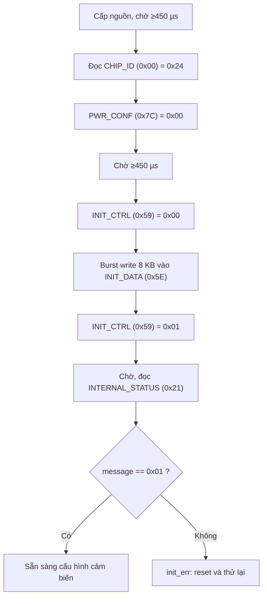

# BMI270 – Cách hoạt động, cách sử dụng và hiệu chỉnh tham số

> **Nguồn:** *BMI270 Data sheet*, Bosch Sensortec, Document number `BST-BMI270-DS000-05`, Revision 1.3 (Nov 2020), 162 trang.
>
> **Cách đọc trích dẫn:** `[§4.5, tr.28]` nghĩa là *mục 4.5, trang 28 của PDF gốc* (số trang in ở đầu mỗi trang, "xx | 162").
> Các mục con không đánh số trong datasheet được trích theo **tên mục + trang**.

---

## 1. Tổng quan và nguyên lý hoạt động

### 1.1 Cảm biến gồm những gì `[Basic Description, tr.2; §4.1, tr.25]`

- **IMU 6 trục**: gia tốc kế 3 trục 16-bit (±2/±4/±8/±16 g) (g là gia tốc trọng trường chuẩn = 9,81m/s2) + con quay 3 trục 16-bit (±125/±250/±500/±1000/±2000 dps).
- Gia tốc kế đo **lực/gia tốc tác dụng lên cảm biến → báo 0 khi rơi tự do**. Con quay đo tốc độ quay → **báo 0 khi đứng yên** `[§4.1, tr.25]`.
- Gói LGA 14 chân, 2.5 × 3.0 mm, cao 0.83 mm.
- Nguồn: **VDD 1.71–3.6 V**, **VDDIO 1.2–3.6 V** độc lập `[Table 1, tr.12; §4.3, tr.26]`.
- FIFO **2 KB** cho accel, gyro, AUX và timestamp `[Basic Description, tr.2; §4.7, tr.37]`.
- Có **Feature engine** (any-motion, no-motion, significant motion, step counter, wrist gesture…) hoạt động dựa trên mẫu gia tốc `[Basic Description, tr.2; §4.8, tr.46–47]`.
- **Giao diện thứ cấp** cấu hình được: **I²C master (AUX)** để gắn cảm biến ngoài (ví dụ từ kế → hệ 9-DoF), hoặc **SPI slave cho OIS** `[§4.1, tr.25; §6.1, tr.131]`.

### 1.2 Nguồn và các chế độ công suất `[§4.5, tr.28–29, Table 6]`

Chế độ được quyết định bởi `PWR_CTRL` (0x7D), `PWR_CONF` (0x7C), `ACC_CONF.acc_filter_perf`, `GYR_CONF.gyr_filter_perf`, `GYR_CONF.gyr_noise_perf`.

| Chế độ | acc_en | gyr_en | acc_filter_perf | gyr_filter_perf | gyr_noise_perf | adv_power_save | Dòng điển hình |
|---|:-:|:-:|:-:|:-:|:-:|:-:|---|
| Suspend | 0 | 0 | X | X | X | 1 | **3.5 µA** |
| Configuration | 0 | 0 | X | X | X | 0 | **120 µA** |
| Low power – accel | 1 | 0 | 0 | X | X | 1 | tới **4 µA** (tùy `ACC_CONF`) |
| Low power – gyro | 0 | 1 | X | 0 | 0 | 1 | tới **420 µA** |
| Low power – IMU | 1 | 1 | 0 | 0 | 0 | 1 | tới **420 µA** |
| Normal – accel | 1 | 0 | 1 | X | X | X | 210 µA |
| Normal – gyro | 0 | 1 | X | 1 | 0 | X | 600 µA |
| **Normal – IMU** | 1 | 1 | 1 | 1 | 0 | X | **685 µA** |
| Performance – gyro | 0 | 1 | X | 1 | 1 | X | 900 µA |
| **Performance – IMU** | 1 | 1 | 1 | 1 | 1 | X | **970 µA** |

Ghi chú từ datasheet `[tr.28–29]`:
- Chế độ công suất **không ảnh hưởng chất lượng dữ liệu**; chất lượng (nhiễu, bộ lọc) do `ACC_CONF`/`GYR_CONF` quyết định.
- `adv_power_save = 1` thì **mỗi lần ghi thanh ghi cần cách nhau ≥ 450 µs**, và muốn đọc FIFO phải tắt `adv_power_save` trước.
- `adv_power_save = 0` thì truy cập bình thường sau 450 µs.
- `PWR_CTRL` mặc định tắt hết cảm biến.
- Sau POR/soft-reset, chip luôn ở **Suspend** (`PWR_CONF` mặc định 0x03) `[§4.4, tr.27; Quick Start, tr.19]`.

### 1.3 Xử lý dữ liệu và bộ lọc `[§4.6, tr.30–33]`

- **Accel – Normal/Performance** (`acc_filter_perf=1`): lấy mẫu đều theo `acc_odr`, lọc thông thấp. Với `acc_bwp=0x02` (normal), tần số cắt −3 dB: 5.5 / 11 / 22 / 44 / 89 / 178 / 343 / 740 Hz tương ứng ODR 12.5 / 25 / 50 / 100 / 200 / 400 / 800 / 1600 Hz (Table 7). Nhiễu RMS typ. ở ±8 g: 0.38 → 4.35 mg (Table 8). Group delay: 80 → 0.6 ms (Table 9).
- **Accel – Low power** (`adv_power_save=1` và `acc_filter_perf=0`): chu kỳ ngủ/thức, **trung bình `2^acc_bwp` mẫu** trong pha hoạt động. Số mẫu trung bình tăng thì nhiễu giảm nhưng dòng tăng `[tr.31]`.
- **Gyro – Normal/Performance** (`gyr_filter_perf=1`): ODR 25 Hz–3.2 kHz (6.4 kHz qua FIFO). Tần số cắt −3 dB với `gyr_bwp=0x02`: 11 / 20 / 39 / 77 / 152 / 300 / 557 / 751 / 712 Hz cho ODR 25 → 6.4 kHz (Table 10) `[tr.32]`. Nhiễu RMS ở ±2000 dps: Normal 31 → 500 mdps (Table 11), Performance 21.7 → 350 mdps (Table 12) `[tr.32–33]`.
- **Gyro – Low power**: chỉ ODR 25/50/100 Hz, trung bình 4 mẫu `[§4.6 Gyroscope Data Processing in Low Power Mode, tr.33]`.
- Nhiễu mật độ phổ gyro: **Performance < 7 mdps/√Hz**, Normal 10 mdps/√Hz `[Table 3, tr.16]`.

### 1.4 Sensor time (đồng hồ nội 24-bit) `[§4.6 Sensor Time, tr.35; thanh ghi 0x18–0x1A, tr.87–88]`

- Bộ đếm tự chạy 24-bit, **39.0625 µs/LSB**, tràn tại `0xFFFFFF` (chu kỳ 2^24 × 39.0625 µs ≈ 655.36 s, 🟡 tính từ độ phân giải).
- Mọi cập nhật thanh ghi dữ liệu/FIFO đồng bộ với bit tương ứng của sensor time.
- Khi **burst-read cùng thanh ghi dữ liệu**, giá trị sensor time được chốt (shadow) nhất quán.

### 1.5 Thay đổi cấu hình khi cảm biến đang chạy `[§4.6 Configuration Changes, tr.36]`

Nếu đổi `ACC_CONF`, `ACC_RANGE`, `GYR_CONF`, `GYR_RANGE`, `AUX_CONF` khi cảm biến đang bật, thay đổi **không có hiệu lực ngay**. Nó chỉ có hiệu lực khi một mốc lấy mẫu của ODR đang chạy trùng một mốc của ODR mới trên lưới sensortime. Nếu ODR không đổi thì có hiệu lực ở mẫu kế tiếp.

---

## 2. Giao tiếp phần cứng

### 2.1 Chọn giao thức `[§6.3, tr.133]`

- Mặc định sau reset/power-up là **I²C**. Nên nối cứng `CSB` lên VDDIO nếu dùng I²C.
- Nếu `CSB` có **cạnh lên** sau power-up thì giao diện chuyển sang **SPI** (sau 200 µs) cho đến khi reset.
- Khuyến nghị: **đọc một lần `CHIP_ID` qua SPI trước** (giá trị đầu sẽ không hợp lệ) để kích hoạt SPI.
- Hoặc đặt `NV_CONF.spi_en` để cố định SPI mà không cần toggle `CSB` mỗi lần.

### 2.2 SPI `[§6.4, tr.133–137]`

- Tối đa **10 MHz** (VDDIO ≥ 1.62 V), **7 MHz** nếu VDDIO < 1.62 V (Table 19).
- Hỗ trợ **Mode 0 (CPOL=0, CPHA=0)** và **Mode 3 (CPOL=1, CPHA=1)** `[tr.134]`.
- 4-dây mặc định; 3-dây bật bằng `IF_CONF.spi3 = 1` (0x6B) `[tr.134, 137; IF_CONF, tr.124]`.
- **Đọc SPI luôn có 1 byte dummy đầu**: đọc *n* byte thì phải clock *n+1* byte và bỏ byte đầu `[tr.136; Quick Start, tr.19]`.
- Địa chỉ tự tăng khi `CSB` còn thấp (trừ `FIFO_DATA` và `INIT_DATA`) `[§5.1, tr.75]`.

### 2.3 I²C `[§6.5, tr.138–141]`

- Địa chỉ 7-bit: **0x68** nếu `SDO` nối GND; **0x69** nếu `SDO` nối VDDIO `[tr.138]`.
- Hỗ trợ standard (100 kHz), fast, **fast mode plus (tới 1 MHz)**, chỉ 7-bit address.
- **Đọc I²C không có dummy byte** `[Quick Start, tr.19]`.

### 2.4 Khoảng nghỉ sau lệnh ghi `[Table 19, tr.133–134; §6.5 "Post-Write Access Timing Constraints", tr.141]`

- Normal mode / fast-startup: nghỉ **≥ 2 µs** sau ghi.
- Suspend / Low-power (hoặc `adv_power_save=1`): nghỉ **≥ 450 µs** giữa các lần ghi.
- Sau soft-reset hoặc POR: các thanh ghi truy cập được sau **450 µs**; Table 1 ghi `tPO` (từ khi cấp nguồn đến giao diện sẵn sàng) tối đa **2 ms** `[§4.4, tr.27; Table 1, tr.13]`.

---

## 3. Khởi tạo bắt buộc (nạp config file)

> **Quan trọng:** BMI270 **bắt buộc** nạp file cấu hình ~8 KB (`bmi270_config_file`) vào `INIT_DATA` sau mỗi POR/soft-reset. Nếu không, feature engine và các tính năng phụ thuộc không chạy.
> Datasheet dẫn tới file này trên GitHub: `BoschSensortec/BMI270-Sensor-API` → `bmi270.c` `[§4.4, tr.27; Quick Start chú thích 3, tr.20]`.

### 3.1 Trình tự `[§4.4, tr.27; Quick Start "1. Testing communication and initializing", tr.19–21]`

1. Chờ ≥ 450 µs sau khi nguồn ổn định.
2. Đọc `CHIP_ID` (0x00), **kỳ vọng 0x24** `[tr.19, 81]`.
3. `PWR_CONF.adv_power_save = 0` → ghi **0x00** vào 0x7C.
4. Chờ **≥ 450 µs** (hoặc 12 LSB của `SENSORTIME_0`).
5. Ghi `INIT_CTRL (0x59) = 0x00` để chuẩn bị nạp.
6. **Burst-write 8 KB** vào `INIT_DATA (0x5E)`, bắt đầu từ byte 0. Ở SPI 10 MHz mất ~**6.6 ms**.
   - Nếu host không burst được 8 KB, có thể chia nhỏ. Giữa 2 lần ghi phải **tăng `INIT_ADDR_0/INIT_ADDR_1` thêm (số byte của khối trước / 2)** `[chú thích 4, tr.27]`.
   - Tùy chọn: đọc ngược `INIT_DATA` để so sánh.
7. Ghi `INIT_CTRL = 0x01` để kết thúc nạp. **Chỉ làm đúng 1 lần sau mỗi POR/soft-reset.**
8. Đọc `INTERNAL_STATUS (0x21)` đến khi `message` (bit 3:0) = **0x01 (`init_ok`)**. Datasheet nói tối đa **20 ms** (§4.4); flow Quick Start chờ **≥ 140 ms** rồi kiểm tra bit 0 `[§4.4, tr.27; Quick Start, tr.21]`.
9. Sau khi xong, chip tự vào **Configuration mode**.

Các giá trị `message` khác: `0x02 init_err`, `0x03 drv_err`, `0x05 nvm_error`, `0x06 start_up_error`, `0x07 compat_error` `[INTERNAL_STATUS, tr.91]`.



---

## 4. Cấu hình ODR, dải đo, bộ lọc

### 4.1 Các thanh ghi `[§5.2: PWR_CTRL tr.129; ACC_CONF tr.108–109; ACC_RANGE tr.109; GYR_CONF tr.110; GYR_RANGE tr.111]`

**`PWR_CTRL` (0x7D)**: bit0 `aux_en`, bit1 `gyr_en`, bit2 `acc_en`, bit3 `temp_en`. Ví dụ **0x0E** = acc + gyr + temp.

**`PWR_CONF` (0x7C)**, mặc định **0x03**: bit0 `adv_power_save`, bit1 `fifo_self_wake_up`, bit2 `fup_en` (fast power-up). Ví dụ **0x02** = tắt power-save, giữ `fifo_self_wake_up`.

**`ACC_CONF` (0x40)**, mặc định **0xA8** (perf=1, bwp=2, ODR 100 Hz):

| Bit | Trường | Giá trị |
|---|---|---|
| 3:0 | `acc_odr` | 0x01=0.78, 0x02=1.5, 0x03=3.1, 0x04=6.25, 0x05=12.5, 0x06=25, 0x07=50, 0x08=100, 0x09=200, 0x0A=400, 0x0B=800, 0x0C=1600 Hz (0x0D–0x0F reserved) |
| 6:4 | `acc_bwp` | Khi `perf=1`: 0=OSR4, 1=OSR2, **2=normal**, 3=CIC. Khi `perf=0`: số mẫu trung bình 1, 2, 4, 8, 16, 32, 64, 128 |
| 7 | `acc_filter_perf` | 0=tiết kiệm điện, 1=hiệu năng cao |

**`ACC_RANGE` (0x41)**, mặc định **0x02 (±8 g)**: `0x00`=±2 g, `0x01`=±4 g, `0x02`=±8 g, `0x03`=±16 g.

**`GYR_CONF` (0x42)**, mặc định **0xA9** (perf=1, noise=0, bwp=2, ODR 200 Hz):

| Bit | Trường | Giá trị |
|---|---|---|
| 3:0 | `gyr_odr` | 0x06=25, 0x07=50, 0x08=100, 0x09=200, 0x0A=400, 0x0B=800, 0x0C=1600, **0x0D=3200 Hz** (0x0E=6.4 kHz reserved trong thanh ghi) |
| 5:4 | `gyr_bwp` | 0=OSR4, 1=OSR2, **2=normal** |
| 6 | `gyr_noise_perf` | 0=tiết kiệm điện, 1=hiệu năng cao (nhiễu thấp) |
| 7 | `gyr_filter_perf` | 0=tiết kiệm điện, 1=hiệu năng cao |

**`GYR_RANGE` (0x43)**, mặc định **0x00 (±2000 dps)**: `0x00`=±2000, `0x01`=±1000, `0x02`=±500, `0x03`=±250, `0x04`=±125 dps.

> 🟡 Đặt `ACC_RANGE`/`GYR_RANGE` rõ ràng ngay khi khởi tạo, vì mặc định là ±8 g / ±2000 dps. Nếu quên và dùng hệ số chia của dải khác thì dữ liệu sẽ sai.

### 4.2 Ba ví dụ cấu hình của chính datasheet `[Quick Start §2–§4, tr.22–24]`

| Ví dụ | Chuỗi ghi (datasheet) |
|---|---|
| **Low power** (chỉ accel 50 Hz) `[tr.22]` | `0x7D←0x04`, `0x40←0x17`, `0x7C←0x03`, rồi `burst_read(0x0C, 6)` |
| **Normal** (IMU) `[tr.23]` | `0x7D←0x0E`, `0x42←0xA9` (gyro 200 Hz), `0x7C←0x02`, `0x40←0xA8` (accel 100 Hz), `burst_read(0x0C, 12)` |
| **Performance** (IMU) `[tr.24]` | `0x7D←0x0E`, `0x42←0xE9` (gyro 200 Hz + noise_perf), `0x7C←0x02`, `0x40←0xA8`, `burst_read(0x0C, 12)` |

Ghi chú: các ví dụ này chưa ghi `ACC_RANGE`/`GYR_RANGE`, nên chạy dải mặc định.

---

## 5. Đọc dữ liệu và đổi sang đơn vị vật lý

### 5.1 Bản đồ thanh ghi dữ liệu `[Register Map, tr.78–79; §4.6, tr.30–31]`

| Địa chỉ | Nội dung |
|---|---|
| `0x0C`–`0x11` (DATA_8–13) | Accel X(LSB, MSB), Y, Z |
| `0x12`–`0x17` (DATA_14–19) | Gyro X(LSB, MSB), Y, Z |
| `0x18`–`0x1A` | SENSORTIME_0–2 |
| `0x22`–`0x23` | TEMPERATURE_0–1 |
| `0x03` STATUS | bit7 `drdy_acc`, bit6 `drdy_gyr`, bit5 `drdy_aux`, bit4 `cmd_rdy`, bit2 `aux_busy` |

- Dữ liệu 16-bit **bù 2**, tách MSB/LSB.
- **Shadowing:** *luôn đọc LSB trước*; việc đọc thanh ghi LSB sẽ khóa MSB tương ứng để mẫu nhất quán `[§4.6 Accelerometer Data, tr.30; Gyroscope Data, tr.31]`.
- Một nhóm thanh ghi (STATUS, DATA_x, SENSORTIME_x, TEMPERATURE_x, …) được shadow khi **bắt đầu burst read** trong nhóm đó `[§5.1, tr.75]`.
- 🟡 Cách dùng thực tế: burst-read **12 byte từ 0x0C** (như Quick Start tr.23–24) để lấy accel + gyro cùng thời điểm.
- Cờ `STATUS.drdy_acc/gyr` tự xóa khi đọc thanh ghi MSB-X tương ứng `[§5.1, tr.75]`.

Ghép số nguyên:

```text
raw = (int16_t)((MSB << 8) | LSB)
```

### 5.2 Accel `[Table 2, tr.13]`

```text
a[g] = raw_acc / Sensitivity        (nhân 9.80665 để ra m/s²)
```

| Dải | Sensitivity |
|---|---|
| ±2 g | 16384 LSB/g |
| ±4 g | 8192 LSB/g |
| ±8 g | 4096 LSB/g |
| ±16 g | 2048 LSB/g |

Kiểm tra nhanh: Datasheet §8.2 có bảng cho thấy ở dải ±4 g, trục hướng xuống đọc ≈ **8192 LSB** `[§8.2 Orientation, tr.156]`.

### 5.3 Gyro `[Table 3, tr.15]`

```text
ω[dps] = Rate / Sensitivity         (nhân π/180 để ra rad/s)
```

| Dải | Sensitivity |
|---|---|
| ±2000 dps | 16.384 LSB/dps |
| ±1000 dps | 32.768 LSB/dps |
| ±500 dps | 65.536 LSB/dps |
| ±250 dps | 131.072 LSB/dps |
| ±125 dps | 262.144 LSB/dps |

(Mô tả thanh ghi `GYR_RANGE` làm tròn 16.4 / 32.8 / 65.6 / 131.2 / 262.4 `[tr.111]`; dùng giá trị chính xác ở Table 3.)

### 5.4 Nhiệt độ `[Table 4, tr.17; §4.6 Temperature Sensor, tr.34; TEMPERATURE_0, tr.92]`

```text
T[°C] = 23 + (int16_t)raw_temp / 512
```

- `0x0000` = 23 °C, độ phân giải 1/2^9 K/LSB, dải đo −41 … +87 °C.
- **`0x8000` = không hợp lệ**. Sau khi bật cảm biến nhiệt, thanh ghi giữ 0x8000 đến lần đo đầu tiên.
- Khi gyro bật, nhiệt độ cập nhật tự động ~**100 Hz (±12 %)** (mỗi ~10 ms). Nếu chỉ dùng accel thì phải bật `PWR_CTRL.temp_en` thủ công, và tốc độ cập nhật là 0.78 Hz. Tắt cảm biến nhiệt giảm ~1.8 µA.

---

## 6. Hiệu chỉnh và bù sai số

Thông số lệch của chip (Table 2, 3, tr.13–17), để thấy vì sao cần hiệu chỉnh:

| Thông số | Giá trị nêu trong bảng |
|---|---|
| Accel zero-g offset (hàn, theo tuổi thọ) | ±20 mg |
| Accel sensitivity error | ±0.4 % |
| Gyro zero-rate offset | ±0.5 dps |
| Gyro sensitivity error | ±2 %, giảm còn **±0.4 % sau CRT** |
| Gyro g-sensitivity | 0.1 dps/g |

### 6.1 Hậu xử lý gyro (CAS) – bắt buộc để đạt hiệu năng tối ưu `[§4.6 Gyroscope Data Post-Processing, tr.32; GYR_CAS, tr.95–96]`

```text
Rate_x = (DATA_15<<8 | DATA_14) − GYR_CAS.factor_zx × (DATA_19<<8 | DATA_18) / 2^9
Rate_y = (DATA_17<<8 | DATA_16)
Rate_z = (DATA_19<<8 | DATA_18)
```

(Datasheet in "/ 29", tức **/ 2^9 = / 512**; chỉ số mũ bị mất định dạng trong PDF.)

- `GYR_CAS.factor_zx` là **7-bit bù 2** (bit 6:0), **cần sign-extend** nếu không dùng API của Bosch.
- Đây là thanh ghi **chỉ đọc** nằm ở **FEATURES Page 0, địa chỉ 0x3C** `[Features Pages, tr.80]`. Để đọc: ghi `FEAT_PAGE (0x2F) = 0`, rồi đọc 0x3C `[tr.93, 46]`. Truy cập FEATURES theo **word 16-bit** (xem quy tắc căn chẵn/lẻ `[§4.8.1, tr.46]`).
- 🟡 Cần chip đã init xong mới đọc được. Giá trị này là hằng số hiệu chỉnh của từng chip, nên đọc một lần sau init rồi dùng lại.

### 6.2 Bù offset accel `[§4.13 Accelerometer, tr.70; OFFSET_0–2, tr.126–127; NV_CONF, tr.126]`

- Thanh ghi `OFFSET_0..2` (0x71–0x73): **8-bit bù 2**, **3.9 mg/LSB**, tầm **±0.5 g**, **độc lập với dải đo**.
- Bật bằng `NV_CONF.acc_off_en = 1` (0x70, bit 3).
- Offset được **cộng** vào dữ liệu trước-lọc và sau-lọc (có chặn bão hòa). Sau khi sửa thanh ghi, **mẫu kế tiếp không hợp lệ**.
- Các thanh ghi này là *ảnh* của NVM; nạp lại từ NVM mỗi lần reset. Có thể ghi đè bất cứ lúc nào.
- Datasheet gọi quy trình **FOC (semi-automatic)**: *tự xác định giá trị bù bằng cách bù thủ công, rồi lưu vĩnh viễn vào NVM* (§6.5 dưới). Datasheet **không** có lệnh FOC tự động cho BMI270.

🟡 **Gợi ý quy trình (không nằm trong datasheet):**
1. Đặt module nằm tĩnh, từng hướng đã biết (ví dụ Z hướng lên: X=0 g, Y=0 g, Z=+1 g).
2. Lấy trung bình N mẫu (vài trăm) → `bias_g = measured − expected`.
3. Giá trị ghi: `off_acc = −round(bias_g × 1000 / 3.9)`, kẹp trong [−128, 127]. Dấu âm vì offset được *cộng* vào dữ liệu.

### 6.3 Bù offset gyro `[§4.13 Gyroscope, tr.70–71; OFFSET_3–6, tr.127–128]`

- `OFFSET_3..5` (0x74–0x76) là 8 bit thấp của X/Y/Z, 2 bit cao nằm trong `OFFSET_6` (0x77, bit 5:0). Mỗi trục **10-bit bù 2**, **61 mdps/LSB**, tầm **±31 dps**, độc lập dải đo.
- Bật bằng `OFFSET_6.gyr_off_en = 1` (bit 6).
- **Thủ công:** ghi các thanh ghi; mẫu kế tiếp không hợp lệ.
- **IOC – tự động hoàn toàn (In-use Offset Compensation)** `[tr.71]`: chip tự theo dõi và cập nhật `OFFSET_3..6` mà không cần host. Chỉ chạy khi **tất cả** điều kiện sau đúng:
  - `GEN_SET_1.gyro_self_off = 1` (FEATURES **Page 1**, 0x34, bit 9),
  - `OFFSET_6.gyr_off_en = 1`,
  - accel được bật (từ primary hoặc OIS),
  - gyro bật từ primary interface,
  - gyro **không** bật từ OIS.
- Khi IOC bật, **host không được ghi `OFFSET_3..6`**. Cách tắt khuyến nghị: xóa `GEN_SET_1.gyro_self_off`.

🟡 **Gợi ý quy trình thủ công:** để module đứng yên, lấy trung bình gyro N mẫu → `bias_dps`; ghi `off = −round(bias_dps × 1000 / 61)`, kẹp [−512, 511], tách thành 8 bit thấp (OFFSET_3/4/5) và 2 bit cao (OFFSET_6).

### 6.4 Bù độ nhạy (gain) gyro `[§4.14, tr.72–73]`

Accel đã có độ nhạy ổn định ngay từ thiết kế (xem §1 Specifications). Gyro có hai cách:

**(a) Thủ công** (cần quay thiết bị so với hệ chuẩn) `[tr.72; GYR_GAIN_UPD_1–3, tr.98; GYR_GAIN_STATUS, tr.95]`
- Điều kiện: đã bù offset gyro, `OFFSET_6.gyr_gain_en = 1`.
- Nếu gyro đo ω_m còn hệ chuẩn đo ω_r, ghi **tỉ số ω_r/ω_m** vào `GYR_GAIN_UPD_1/2/3` (FEATURES Page 1, 0x36/0x38/0x3A), định dạng **Q(1,10), 11-bit**, dải 0.75–1.25, độ phân giải 2^−10 (≈0.0977 %). Ví dụ 0.75 = `0x300`, 1.25 = `0x500`.
- Quy trình: đặt `GYR_GAIN_UPD_3.enable (bit 11) = 1` → **tắt gyro** (`PWR_CTRL.gyr_en = 0`) → gửi lệnh `usr_gain` (**0x03**) vào `CMD` (0x7E) → chờ `enable` tự xóa → bật lại gyro.
- Nếu chạm giới hạn bù, `GYR_GAIN_STATUS.sat_x/y/z` báo.

**(b) CRT – Component ReTrim (đứng yên, không cần quay)** `[tr.73; G_TRIG_1, tr.96; GYR_CRT_CONF tr.123]`

1. Soft-reset (`CMD=0xB6`) hoặc POR.
2. Khởi tạo lại thiết bị (§3 trên).
3. `PWR_CONF.adv_power_save = 0`, chờ 450 µs.
4. Bật accel: `PWR_CTRL.acc_en = 1`.
5. **Giữ thiết bị hoàn toàn đứng yên.**
6. `GYR_CRT_CONF.crt_running = 1` (0x69).
7. `G_TRIG_1.select = 1` (FEATURES Page 1, 0x32, bit 8 → chọn CRT).
8. `G_TRIG_1.block = 0` (bit 9).
9. Gửi `g_trigger` (**0x02**) vào `CMD`.
10. Xong khi `GYR_CRT_CONF.crt_running` về 0.
11. Đọc `GYR_GAIN_STATUS.g_trig_status` (Page 0, 0x38, bit 5:3): `0x00` OK, `0x01` precondition error, `0x02` download error, `0x03` bị hủy (có chuyển động hoặc do host).
12. (Tùy chọn) lưu vào NVM (§6.5).
13. Gain mới tự áp dụng ở lần khởi động gyro kế tiếp.

- Nếu phát hiện chuyển động trong lúc chạy, CRT bị hủy, gain giữ nguyên (`g_trig_status = 0x03`).
- CRT chạy được trong toàn dải nhiệt độ; datasheet **khuyến nghị chạy ở nhiệt độ hoạt động**, vì sai số nhạy thấp nhất tại nhiệt độ lúc chạy CRT. Khuyến nghị cho hiệu chuẩn một lần; cả CRT một lần và lặp lại đều được hỗ trợ.
- Hiệu quả: sai số độ nhạy gyro **±2 % → typ. ±0.4 %** `[Table 3, tr.15; Basic Description, tr.2]`.

### 6.5 Lưu hiệu chuẩn vào NVM `[§4.15, tr.73–74; Table 1, tr.13]`

Các thanh ghi `NV_CONF`, `OFFSET_0..6`, `AUX_IF_TRIM`, `DRV` có bản sao NVM; gain gyro cũng được lưu. NVM nạp vào thanh ghi ảnh sau mỗi reset (trong lúc nạp, `STATUS.cmd_rdy = 0`).

Quy trình ghi `[tr.73]`:
1. `PWR_CONF.adv_power_save = 0`.
2. Ghi giá trị mới vào các thanh ghi ảnh.
3. `GEN_SET_1.nvm_prog_prep = 1` (Page 1, 0x34, bit 10).
4. **Chờ 40 ms.**
5. Ghi `NVM_CONF.nvm_prog_en = 1` (0x6A, bit 1) để mở khóa.
6. Ghi `nvm_prog` (**0xA0**) vào `CMD`.
7. Tắt nguồn hoặc reset (POR/soft-reset).

Lưu ý thêm `[tr.74]`: mỗi lần ghi NVM **ghi lại toàn bộ NVM** và bị giới hạn **14 chu kỳ**. Kiểm tra tiến độ bằng `STATUS.cmd_rdy` (0 = đang ghi, 1 = xong). Trong lúc đang đọc/ghi NVM, các lệnh ghi thanh ghi bị bỏ và lệnh đọc trả về `STATUS`. Không soft-reset khi đang ghi NVM.

### 6.6 Remap trục `[§4.8.1 Axis remapping, tr.47; GEN_SET_1, tr.97; §8.2, tr.155–156]`

- `GEN_SET_1.map_x/y/z_axis` và `*_sign` ánh xạ trục (kể cả đảo dấu) **chỉ cho các feature thông minh**.
- **Không ảnh hưởng** `DATA_0..13` và FIFO, nên phải remap ở driver phía host.
- Remap sai (hai trục trùng nhau) được báo bằng `INTERNAL_STATUS.axes_remap_error`.

### 6.7 Tự kiểm tra (self-test) `[§4.12, tr.68–69]`

- **Accel**: dùng ±16 g, ODR 1600 Hz, `acc_self_test_amp=1`; bật/tắt dấu dương/âm, đọc chênh lệch. Đạt khi chênh lệch tối thiểu: X > +16 g, Y < −15 g, Z > +10 g (theo bảng datasheet). Nên reset sau test.
- **Gyro**: init → tắt APS → bật accel → đứng yên → gửi `g_trigger` (đặt `G_TRIG_1.select = 0` cho BIST) → chờ `gyr_st_axes_done = 1` → `gyr_axis_[xyz]_ok = 1` là đạt. Lỗi drive test báo qua `ERR_REG.fatal_err` trong ≤ 320 ms.

---

## 7. FIFO (tóm tắt) `[§4.7, tr.37–45]`

- Dung lượng **2048 byte**; 2 chế độ: **Streaming** (ghi đè dữ liệu cũ khi đầy) và **FIFO mode** (bỏ dữ liệu mới khi đầy) `[tr.37]`.
- Bật nguồn dữ liệu: `FIFO_CONFIG_1.fifo_acc_en / fifo_gyr_en / fifo_aux_en`.
- Frame có **header 1 byte** (chế độ mặc định) gồm `fh_mode`, `fh_parm` (cảm biến nào có mặt), `fh_ext`; hoặc *headerless* `[tr.38]`.
- Thứ tự dữ liệu trong frame FIFO là **AUX → GYR → ACC** (khác thứ tự DATA_x) `[tr.39]`.
- Đọc bằng **burst** tại `FIFO_DATA (0x26)` (địa chỉ không tăng). Số byte hiện có: `FIFO_LENGTH_0/1` (0x24–0x25). Xóa FIFO bằng `CMD = 0xB0` `[tr.92–93, 130]`.
- Ở low-power mode muốn đọc FIFO phải tắt `adv_power_save` `[tr.29]`.
- **6.4 kHz gyro chỉ dùng được qua FIFO** `[tr.32]`.

---

## 8. Reset và báo lỗi

- **Soft-reset:** ghi `0xB6` vào `CMD`; gần như tương đương power cycle; mọi cấu hình về mặc định (giá trị NVM); chờ như power-on trước khi truy cập; không làm khi đang ghi NVM `[§4.17, tr.74; CMD, tr.130]`. Sau reset **phải init lại (nạp config file)**.
- **Báo lỗi** `[§4.16, tr.74]`:
  - `ERR_REG (0x02)`: `fatal_err` (bit0), `internal_err` (bit4:1), `fifo_err` (bit6), `aux_err` (bit7). Xóa khi đọc, riêng `fatal_err` chỉ xóa bằng POR/soft-reset `[tr.81]`.
  - `EVENT (0x1B)`: `por_detected`, `error_code` (cấu hình `ACC_CONF`/`GYR_CONF` sai).
  - `INTERNAL_STATUS (0x21)`: trạng thái init, remap lỗi, `odr_50hz_error`.
  - Feature engine cần ODR accel **≥ 50 Hz** `[§4.8.1, tr.47]`.

---

## 9. Bảng tra thanh ghi quan trọng `[§5.2 Register Map, tr.76–80]`

| Địa chỉ | Tên | Ghi chú |
|---|---|---|
| 0x00 | `CHIP_ID` | 0x24 |
| 0x02 | `ERR_REG` | fatal/internal/fifo/aux error |
| 0x03 | `STATUS` | drdy_acc(7), drdy_gyr(6), drdy_aux(5), cmd_rdy(4), aux_busy(2) |
| 0x0C–0x11 | `DATA_8–13` | Accel X/Y/Z |
| 0x12–0x17 | `DATA_14–19` | Gyro X/Y/Z |
| 0x18–0x1A | `SENSORTIME_0–2` | 39.0625 µs/LSB |
| 0x1B | `EVENT` | por_detected, error_code |
| 0x1C–0x1D | `INT_STATUS_0/1` | xóa khi đọc |
| 0x21 | `INTERNAL_STATUS` | message = 0x01: init_ok |
| 0x22–0x23 | `TEMPERATURE_0–1` | 23 °C + raw/512 |
| 0x24–0x25 | `FIFO_LENGTH_0/1` | số byte trong FIFO |
| 0x26 | `FIFO_DATA` | burst đọc FIFO |
| 0x2F | `FEAT_PAGE` | chọn page FEATURES |
| 0x30–0x3F | `FEATURES[16]` | cấu hình/đầu ra feature (theo page, tr.80) |
| 0x40 | `ACC_CONF` | mặc định 0xA8 |
| 0x41 | `ACC_RANGE` | mặc định 0x02 (±8 g) |
| 0x42 | `GYR_CONF` | mặc định 0xA9 |
| 0x43 | `GYR_RANGE` | mặc định 0x00 (±2000 dps) |
| 0x45–0x4A | `FIFO_DOWNS`, `FIFO_WTM_0/1`, `FIFO_CONFIG_0/1`, `SATURATION` | cấu hình FIFO |
| 0x53–0x58 | `INT1/2_IO_CTRL`, `INT_LATCH`, `INT1/2_MAP_FEAT`, `INT_MAP_DATA` | cấu hình chân ngắt |
| 0x59 | `INIT_CTRL` | 0 = bắt đầu nạp, 1 = kết thúc |
| 0x5B–0x5C | `INIT_ADDR_0/1` | địa chỉ khi nạp chia khúc |
| 0x5E | `INIT_DATA` | cổng nạp config 8 KB |
| 0x69 | `GYR_CRT_CONF` | `crt_running` |
| 0x6A | `NVM_CONF` | `nvm_prog_en` (bit 1) |
| 0x6B | `IF_CONF` | `spi3`, `ois_en`, `aux_en` |
| 0x70 | `NV_CONF` | `acc_off_en` (bit 3), `spi_en` |
| 0x71–0x73 | `OFFSET_0–2` | offset accel |
| 0x74–0x77 | `OFFSET_3–6` | offset gyro; bit6 `gyr_off_en`, bit7 `gyr_gain_en` |
| 0x7C | `PWR_CONF` | mặc định 0x03 |
| 0x7D | `PWR_CTRL` | temp_en(3), acc_en(2), gyr_en(1), aux_en(0) |
| 0x7E | `CMD` | `0x02` g_trigger, `0x03` usr_gain, `0xA0` nvm_prog, `0xB0` fifo_flush, `0xB6` softreset |

---

## 10. Ví dụ C 🟡 (minh họa của người viết, không phải mã của datasheet)

```c
// Giả định: i2c_read(addr, reg, buf, n) / i2c_write(addr, reg, buf, n) của bạn.
// Nếu dùng SPI: nhớ bỏ 1 byte dummy đầu khi đọc.
#define ACC_LSB_PER_G_8G    4096.0f   // ±8 g  (mặc định sau reset!)
#define GYR_LSB_PER_DPS_2K  16.384f   // ±2000 dps (mặc định)

typedef struct { float ax, ay, az, gx, gy, gz; } imu_t;

// factor_zx: đọc 1 lần sau init từ FEAT_PAGE=0, reg 0x3C, bit[6:0], rồi sign-extend 7-bit.
static int8_t sext7(uint8_t v) { return (v & 0x40) ? (int8_t)(v | 0x80) : (int8_t)v; }

void bmi270_read(imu_t *o, int8_t factor_zx) {
    uint8_t d[12];
    i2c_read(0x68, 0x0C, d, 12);                      // accel + gyro, cùng 1 burst (tr.30–31)

    int16_t ax = (int16_t)(d[1]  << 8 | d[0]);
    int16_t ay = (int16_t)(d[3]  << 8 | d[2]);
    int16_t az = (int16_t)(d[5]  << 8 | d[4]);
    int16_t gx = (int16_t)(d[7]  << 8 | d[6]);
    int16_t gy = (int16_t)(d[9]  << 8 | d[8]);
    int16_t gz = (int16_t)(d[11] << 8 | d[10]);

    // Hậu xử lý CAS (§4.6, tr.32): chia 512 = 2^9
    float gx_c = (float)gx - ((float)factor_zx * (float)gz) / 512.0f;

    o->ax = ax / ACC_LSB_PER_G_8G;      // [g]
    o->ay = ay / ACC_LSB_PER_G_8G;
    o->az = az / ACC_LSB_PER_G_8G;
    o->gx = gx_c / GYR_LSB_PER_DPS_2K;  // [dps]
    o->gy = gy   / GYR_LSB_PER_DPS_2K;
    o->gz = gz   / GYR_LSB_PER_DPS_2K;
}
```

---

## 11. Checklist nhanh khi bring-up 🟡

1. Chọn giao thức (I²C: `CSB`→VDDIO; SPI: dummy-read `CHIP_ID`).
2. `CHIP_ID == 0x24`.
3. Nạp config file 8 KB, `INTERNAL_STATUS.message == 0x01`.
4. Đặt `ACC_RANGE`/`GYR_RANGE`, `ACC_CONF`/`GYR_CONF`, rồi `PWR_CTRL = 0x0E`, `PWR_CONF = 0x02`.
5. Đọc `factor_zx` (Page 0, 0x3C) và áp CAS cho trục X gyro.
6. Hiệu chỉnh offset gyro/accel (thủ công hoặc IOC); cân nhắc CRT một lần; lưu NVM nếu cần.
7. Nhớ: sau mọi **soft-reset/POR** phải **nạp lại config file**.

---

*Hết. Mọi nội dung có trích dẫn đều lấy từ datasheet `BST-BMI270-DS000-05` rev 1.3; các mục 🟡 là gợi ý của người viết.*
